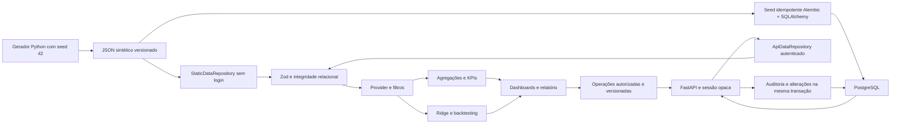

# Arquitetura · demonstração e laboratório

O contrato `DataRepository.load(signal)` é assíncrono e recebe `AbortSignal`. O adaptador estático carrega o JSON pelo prefixo do Vite. O adaptador API faz `GET /api/v1/dataset` com bearer em memória, valida o mesmo contrato e preserva as funções analíticas. `VITE_DATA_MODE=demo` é o padrão; `api` exige login e `VITE_API_BASE_URL`. A escolha da fonte é explícita, identificada na UI e preservada em `sessionStorage`, sem credenciais.

O provider é a origem dos registros e preferências. Agregações, alertas e insights são memoizados. Páginas usam carregamento sob demanda; tabelas renderizam dez linhas. Na demonstração, CSV é local e atômico. No laboratório, admin valida o lote na API e confirma a transação separadamente. Dados operacionais não são guardados no storage do navegador.

`HashRouter` evita resolução de rotas de aplicação no servidor estático. A aplicação não depende de variáveis de ambiente ou chaves. GitHub Actions valida a mesma base e o mesmo build que será publicado.

## Persistência e consistência

SQLAlchemy 2/Psycopg 3 assíncronos, FKs, checks, unicidade e índices em filtros/relacionamentos. A migração cria o schema; não há `create_all()`. A seed transacional mantém IDs e ordem de registros e compara o snapshot reconstruído ao JSON. Repetir seed não desfaz alterações. `NUMERIC(14,2)` e `Decimal` mantêm valores financeiros.

Consultas de snapshot fazem um conjunto fixo de SELECTs em `SERIALIZABLE`, com leitura repetível e sem consulta por registro. A base pequena permite calcular KPIs em Python a partir desses registros; endpoints analíticos não retornam constantes nem leem o JSON estático. Escritas usam advisory lock transacional do dataset. A combinação com isolamento serializável impede write skew entre entidades, inclusive quando a autenticação iniciou o snapshot antes de aguardar o lock. Cada recurso possui versão; conflito retorna 409 e requer recarga. Commit ocorre antes da resposta de sucesso. Alteração e auditoria são atômicas.

CRUD invalida o snapshot, busca novamente os dados e só confirma sucesso após atualizar a UI. Erro de gravação não mantém alterações otimistas. Se a gravação concluir e a recarga falhar, a mensagem distingue esses fatos e bloqueia a exibição de um painel desatualizado. Há atualização a cada 30 segundos e ao voltar à janela, para sincronização entre sessões.

## Limites de arquitetura

## Motor analítico v2

`forecasting/dataset.ts` reconstrói meses completos e limita o treino a `historyStart/historyEnd`. `estimators.ts` contém quatro modelos puros sem estado compartilhado; `evaluation.ts` implementa origens expansivas, métricas e resíduos por passo; `models.ts` orquestra seleção, teste final e reajuste. O contrato anterior continua exportado. Estatísticas descritivas, Wilson, bootstrap e anomalias ficam em `analytics/`, sem uma segunda implementação científica em Python.

Resultados são memoizados por identidade do snapshot, filtros e horizonte; um `WeakMap` permite coleta de snapshots substituídos e cada snapshot mantém no máximo 32 recortes. Identificador de conteúdo usa duas trilhas de 32 bits, tamanho do JSON, versão do modelo, filtros, horizonte e série. Não é hash de segurança. Mudança no snapshot da API invalida a análise; os testes verificam histórico, validação e identificação após persistência. `generated_at` indica criação do resultado; apenas métricas e previsões são determinísticas, não o relógio.

O laboratório roda inteiramente no navegador e continua independente de backend. Custos são normalizados por viajante-dia, sem ratear despesas reais por categoria de hospedagem. Simulação não chama endpoints de gravação nem aloca previsões mensais em hotéis. O custo medido do backtesting completo nesta máquina foi de poucos milissegundos; não houve necessidade de Worker ou infraestrutura adicional.

## Limites de arquitetura

Aplicação de uma agência, sem isolamento por múltiplas organizações. A serialização de escritas favorece consistência neste volume e limita throughput deliberadamente. Não há cache compartilhado, tarefas assíncronas duráveis nem servidor Python publicado. O Ridge continua no navegador e recebe o novo snapshot; testes comprovam mudança da série e novo processamento depois de uma gravação no PostgreSQL.

Somente após homologação da base e dos contratos é apropriado substituir dados demonstrativos. O frontend público atual não deve receber dados pessoais operacionais.
