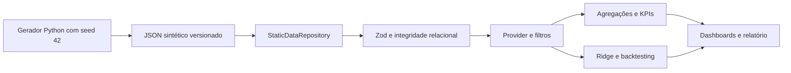

# Arquitetura estática e evolução

O contrato `DataRepository.load(signal)` é assíncrono e recebe `AbortSignal`. O adapter estático faz uma requisição com o prefixo do Vite, sem fingir conexão com banco. Um adapter REST poderá substituir a origem mantendo o contrato validado e as funções analíticas puras.

O provider é a única origem dos registros e preferências da aplicação. Agregações, alertas e insights são memoizados por dados/filtros. Modelos e regras não dependem de componentes React. Páginas secundárias usam carregamento sob demanda. As tabelas ordenam o subconjunto e renderizam dez linhas. Importação é local e atômica; dados não vão ao storage nem à rede.

`HashRouter` evita resolução de rotas de aplicação no servidor estático. A aplicação não depende de variáveis de ambiente ou chaves. GitHub Actions valida a mesma base e o mesmo build que será publicado.

## Futuro adapter REST

API autenticada com autorização por organização e perfil; PostgreSQL com FKs, constraints e índices em `departure_id`, `lead_id`, `route_id`, datas e status. Agregações por período no servidor com paginação e cache. Evitar joins por requisições individuais: endpoints devem devolver snapshot coerente ou visões agregadas. Histórico de confirmação, cancelamento e pagamentos precisa de eventos auditáveis para análises reais de coorte e receita.

Somente após homologação da base e dos contratos é apropriado substituir dados demonstrativos. O frontend público atual não deve receber dados pessoais operacionais.
