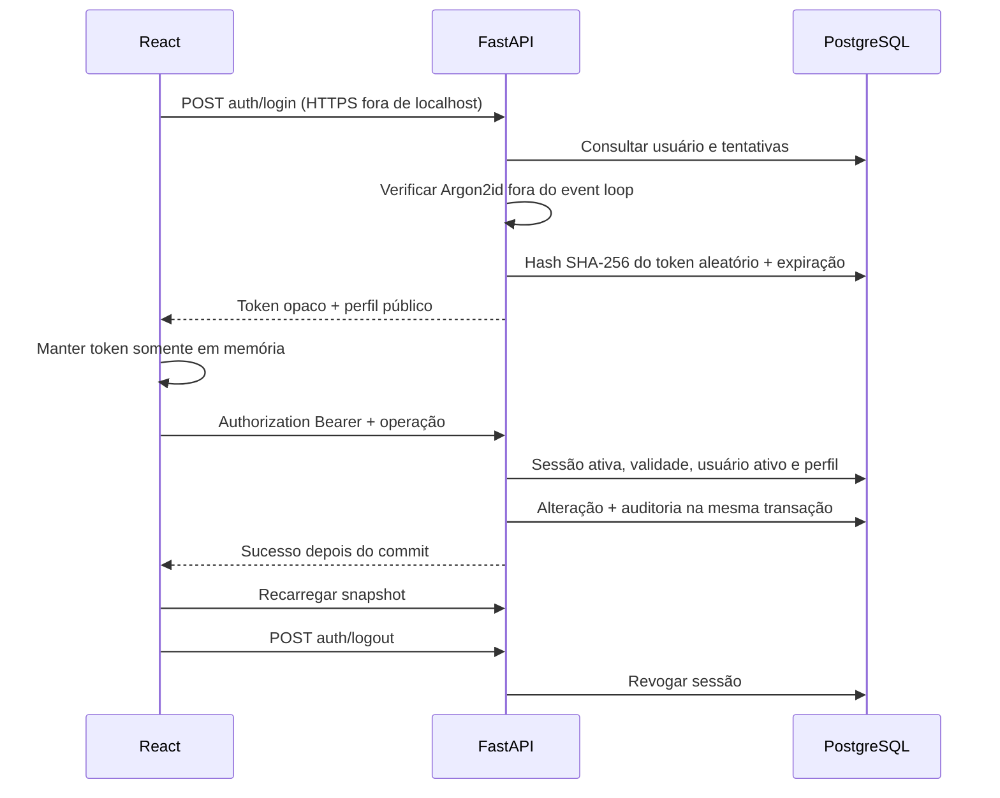

# Autenticação e autorização

O administrador é criado localmente por `python -m app.cli create-admin`, senha por `getpass` ou stdin. Não existem conta/senha padrão, signup público nem senha no README. Admin pode criar e desativar usuários pela UI e API.

Sessão de 60 minutos por padrão, configurável entre 5 e 1440. Apenas hash de token é persistido. Recarregar exige novo login; só o modo escolhido permanece em `sessionStorage`. Não há refresh token/cookie de terceiros. Uma resposta 401 antiga não revoga no cliente um token de sessão mais recente.

| Perfil       | Consulta/análise/exportação | Operação | Importação | Usuários/auditoria global                 |
| ------------ | --------------------------- | -------- | ---------- | ----------------------------------------- |
| Admin        | Sim                         | Sim      | Sim        | Sim                                       |
| Gestor       | Sim                         | Sim      | Não        | Não; pode consultar histórico de reservas |
| Analista     | Sim                         | Não      | Não        | Não                                       |
| Visualizador | Sim                         | Não      | Não        | Não                                       |

Permissões são exigidas no servidor, com 403. Login ausente/inválido/expirado retorna 401. Desativar usuário ou mudar perfil revoga as sessões, inclusive em outros navegadores. O último admin ativo é protegido. Cinco falhas em dez minutos por identidade/IP limitam novas tentativas; respostas não distinguem e-mail inexistente de senha incorreta. Falhas persistem no PostgreSQL, não apenas na memória do processo.

Não foram implementados MFA, recuperação/troca de senha pela interface ou sessão persistente entre recargas. São melhorias futuras; não substituir por tokens no localStorage.
