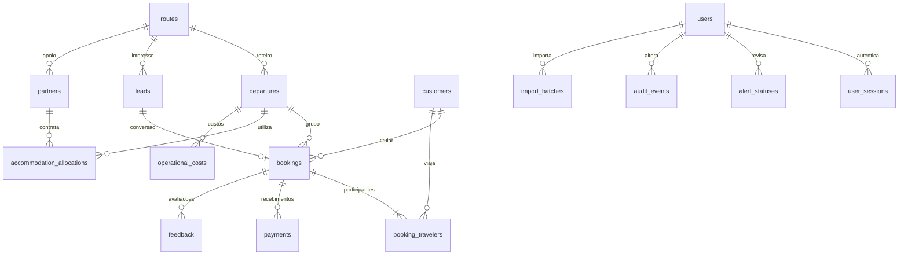

# Contrato e dicionário de dados

Arquivo: `public/data/demo.json`. Contrato executável em `src/types/domain.ts`; validação relacional em `src/lib/validation/dataset.ts`. Valores monetários são totais em BRL, nunca preços oficiais. Todas as datas são ISO `YYYY-MM-DD`; comparações não dependem do fuso do navegador.

| Coleção     | Chave / vínculos                                                                                          | Campos e unidade                                                                                                                                           |
| ----------- | --------------------------------------------------------------------------------------------------------- | ---------------------------------------------------------------------------------------------------------------------------------------------------------- |
| metadata    | objeto único                                                                                              | `source_type=synthetic_demo`, versão, seed, geração determinística, referência, início/fim do histórico, moeda                                             |
| customers   | `id`                                                                                                      | `label` é um identificador fictício; nenhum nome civil ou contato                                                                                          |
| routes      | `id`                                                                                                      | Nome de catálogo de referência, modalidade, países, dias, km ilustrativos e lista ordenada de etapas                                                       |
| departures  | `id`, `routeId → routes`                                                                                  | Início/fim, capacidade de pessoas do grupo, confirmação e prazo do transfer                                                                                |
| leads       | `id`, `routeId → routes`                                                                                  | Data de contato, canal, categoria de interesse, estágio (`new/qualified/proposal/won/lost`), potencial em BRL                                              |
| bookings    | `id`, `customerId → customers`, `travelerIds[] → customers`, `leadId → leads`, `departureId → departures` | Datas de contratação e confirmação, status (`confirmed/pending/cancelled`), categoria, valor **total da reserva**, ficha completa e motivo de cancelamento |
| partners    | `id`, `routeId → routes`                                                                                  | Nome explicitamente demonstrativo e localidade de referência; contrato de apoio ao roteiro, sem parceiro comercial real                                    |
| allocations | `id`, `departureId → departures`, `partnerId → partners`                                                  | Localidade efetiva, data de utilização, categoria, capacidade **do slot** e confirmação do contrato                                                        |
| costs       | `id`, `departureId → departures`                                                                          | Tipo de custo, data da saída, orçamento, valor e status (`realized/estimated`)                                                                             |
| payments    | `id`, `bookingId → bookings`                                                                              | Data e valor recebido; soma não pode ultrapassar a reserva; somente confirmadas                                                                            |
| feedback    | `id`, `bookingId → bookings`                                                                              | Data posterior à viagem, NPS explícito 0–10, atendimento/hospedagem/logística 0–10 e comentário sintético                                                  |

## Granularidade

Uma reserva possui um ou mais viajantes. Seu `totalAmount` já inclui todos: multiplicar esse valor pelos participantes seria duplicação. O titular pertence a `travelerIds`. Uma pessoa não ocupa duas reservas ativas da mesma saída. Um lead possui no máximo uma reserva na simulação; conversão exige vínculo explícito.

Um slot é uma utilização de hospedagem de uma saída em uma data/etapa/categoria. Comprometimento não é digitado: vem dos viajantes de reservas confirmadas da mesma saída e categoria. A soma de múltiplas datas mede **vagas-noite**. Não há estoque próprio de hotéis, quartos nem compensação de faltas com folga de outra data.

## Qualidade e atomicidade

Schemas verificam datas calendáricas, enums, intervalos e campos obrigatórios. A validação relacional verifica PKs, FKs, itinerários, pagamentos, confirmação e datas de feedback. Um snapshot inválido não entra no provider. Importação CSV faz merge por ID em uma nova estrutura, valida tudo e só então troca o estado.

Dados importados continuam sujeitos ao contrato `synthetic_demo`: esta interface não é um canal de ingestão de dados pessoais reais. Preferências e status de revisão são guardados separadamente dos registros. A base original é imutável e restaurável.

## PostgreSQL da etapa 02

As dez coleções são mapeadas para tabelas relacionais; `allocations` corresponde a `accommodation_allocations` e `costs` a `operational_costs`. A associação `booking_travelers` preserva a ordem dos participantes. Colunas seguem `snake_case`; contratos HTTP mantêm `camelCase` do frontend, exceto `source_type`, preservado literalmente.

Tabelas administrativas: `users`, `user_sessions`, `alert_statuses`, `audit_events`, `import_batches`; `dataset_metadata` é necessária para origem, corte e fingerprint da seed. Não há nova massa de dados de negócio.

Recursos operacionais têm `version` e ordem estável de seed. A FK composta dos viajantes referencia reserva/saída/status; índice parcial impede duplicidade de viajante ativo por saída. Dinheiro é `NUMERIC(14,2)`. Sessões têm hash de token, validade e revogação; auditoria nunca contém senha/token. Importações guardam registros normalizados, hash, versões esperadas, responsável, estado e expiração da validação.

Confirmação é um evento histórico: cancelamento futuro preserva `confirmedAt` e pagamentos recebidos. Uma cancelada originalmente sem confirmação continua com `confirmedAt=null`. Um pagamento de cancelada só é aceito quando há confirmação histórica; feedback continua exigindo viagem concluída e reserva confirmada. Não se cria reembolso fictício. Esses casos não alteram os registros ou KPIs originais da versão 1.
