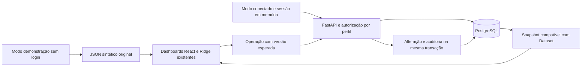

# Entrega 02 · backend, PostgreSQL e integração persistente

## Objetivo e escopo

Evoluir o T4F Performance sem reconstruir seus dez módulos e sem interromper o GitHub Pages. A demonstração permanece independente; o laboratório usa banco real, autenticação, autorização, operações persistentes e auditoria. Todos os dados de negócio continuam classificados como `synthetic_demo`.

Desenvolvimento isolado na branch `feature/backend-postgresql-v1`. Nenhuma massa operacional foi importada e nenhum repositório histórico foi alterado. Não foi criada infraestrutura cloud paga nem publicada uma API simulada.

## Implementação existente

- FastAPI, Python 3.12, Pydantic v2, SQLAlchemy 2 assíncrono, Psycopg 3, Alembic, Argon2id, Uvicorn e Pytest.
- PostgreSQL 18, `NUMERIC(14,2)`, PKs/FKs/checks/índices, versões de recursos, transações e auditoria atômica.
- Migração inicial `2e7e85c7571e`, aplicável do zero. Downgrade/upgrade exercitado somente em banco `_test` descartável. Não há `create_all()` na aplicação.
- `DataRepository` preservado, com adaptadores estático e API; cliente HTTP tipado; bearer em memória; identificação visual da fonte; login, logout e fallback explícito.
- Gerenciamento por modais em Reservas, Hospedagens, Financeiro e Roteiros; revisão de alertas com observação/responsável/data; console administrativo de usuários e auditoria.
- Consultas analíticas no backend e comparação com as funções TypeScript existentes. O Ridge foi preservado e continua no navegador.

## Modelo relacional e dados

Tabelas de negócio: `routes`, `customers`, `leads`, `departures`, `bookings`, `booking_travelers`, `partners`, `accommodation_allocations`, `operational_costs`, `payments`, `feedback`.

Administração: `users`, `user_sessions`, `alert_statuses`, `audit_events`, `import_batches`. `dataset_metadata` guarda o contrato, corte e fingerprint. Diagrama ER completo no [dicionário](data-dictionary.md).

| Entidade do snapshot | Registros carregados |
| -------------------- | -------------------: |
| routes               |                    6 |
| customers            |                  116 |
| leads                |                  258 |
| departures           |                   52 |
| bookings             |                  164 |
| partners             |                   12 |
| allocations          |                  609 |
| costs                |                  156 |
| payments             |                  147 |
| feedback             |                   72 |

O comando `python -m app.cli seed-demo` foi executado duas vezes no laboratório: a primeira informou `equivalentSnapshot=true`; a segunda, `alreadySeeded=true`, com as mesmas contagens. IDs, ordem das coleções e relações foram preservados. O JSON original não foi modificado.

## Operações e endpoints

API protegida em `/api/v1`: autenticação (`login/me/logout`), dataset/metadados, cinco endpoints analíticos, consultas paginadas e criação/edição de reservas, saídas, slots e custos. Reservas têm histórico; alertas têm revisão persistida; importações têm validação e commit separados. Administração oferece criação/desativação de usuários e auditoria paginada. `/health` não depende do banco; `/ready` verifica schema/seed e banco. Contratos e códigos HTTP em [API](api.md).

Confirmação respeita capacidade física do grupo e hospedagem e ficha pré-viagem exigível. Não há DELETE de reserva. Cancelamentos futuros preservam confirmação histórica e recebimentos, sem gerar estorno fictício. Cancelar viagem já iniciada ou criar incoerência de datas é recusado. Importação é transacional, idempotente por conteúdo normalizado, limitada a 1 MB/500 linhas e protegida por versões esperadas.

## Evidências de persistência

O teste de integração autentica um gestor, altera uma reserva, consulta diretamente `bookings.total_amount` no PostgreSQL, faz logout, inicia nova sessão e confirma o mesmo valor na API e no histórico. A auditoria contém estado anterior/posterior, ator e request ID; não contém senha ou token.

O Playwright conectado usa HTTP real, API Uvicorn e PostgreSQL. Edita o valor de `T4F-0001` pelo modal React, salva, faz logout/recarga/login e confere o valor persistido e o histórico. Também verifica que token não foi gravado no storage, que visualizador não tem controles de escrita, que a revisão de um alerta reaparece em nova sessão e que erro da API mantém a origem conectada até a escolha explícita da demonstração.

Um segundo teste altera participantes de uma reserva histórica autorizada, recarrega o snapshot de uma nova sessão e executa as funções TypeScript reais. A série mensal reduz uma participação no mês correspondente e o Ridge/baseline é novamente processado a partir da nova série, sem fator artificial. O teste não exige alteração arbitrária em todas as previsões.

## Validação executada

- 45 testes Vitest: testes anteriores mais cliente HTTP, sessão em memória, HTTPS, cancelamento e ausência de fallback silencioso.
- 23 testes Pytest com PostgreSQL real: seed/snapshot, autenticação/revogação/expiração, perfis, CRUD, FKs/checks, rollback, versões, auditoria, paginação/filtros/ordenação, importação, limites, CORS, erros controlados, downgrade/upgrade, paridade em seis recortes e concorrência real entre administradores sem permitir a desativação simultânea de ambos.
- 12 testes Playwright da demonstração: dez páginas, desktop/celular, filtros, CSV, navegação, ausência de erros de console/ativos e impressão.
- 5 testes Playwright conectados: login, gravação/nova sessão/histórico/logout, perfil de consulta, erro da API/fallback explícito, revisão persistente de alerta e criação/desativação de usuário com paginação de auditoria.
- TypeScript e build de produção aprovados nas verificações locais. A CI executa novamente frontend, PostgreSQL descartável, migrações, Pytest, paridade e Playwright conectado antes de permitir deployment do Pages em `main`.

Evidências locais são geradas em `artifacts/`, incluindo `connected-reservations.png` e log dos serviços; são ignoradas pelo Git para não publicar dados de sessões de teste. Senhas temporárias ficam apenas em memória e as contas/sessões do teste são desativadas/revogadas ao final.

## Execução e estado de deployment

Consulte [backend/README.md](../backend/README.md). Há Dockerfile não root, Compose com PostgreSQL/API, volume persistente, healthchecks e configuração por ambiente. Alternativa sem Docker foi executada com cluster PostgreSQL 18 isolado, em loopback e porta 55432, com bancos exclusivos de laboratório/testes. A API é executável por `python -m app.server` e o administrador é criado pelo CLI com senha local sem eco.

O Docker CLI estava instalado, mas o daemon Docker não estava iniciado nesta máquina. Portanto a execução em containers não é reivindicada como testada; a implementação foi validada diretamente no PostgreSQL real. A CI Linux usa container PostgreSQL descartável. A API externa continua pendente de hospedagem HTTPS e credenciais/infraestrutura próprias. O Pages público permanece em demonstração; não representa integração de produção com PostgreSQL.

## Limites e próxima etapa

- Sessão somente em memória, sem MFA/recuperação de senha ou refresh token.
- Limite geral de requisições por processo; login com limite persistente. Sem retenção automática dos eventos/lotes.
- Mesmo papel SQL para migração/runtime no laboratório; separar em produção. Backups, recuperação e proxy TLS devem ser homologados antes de publicação externa.
- Datas do cenário continuam congeladas em novembro de 2026. Não há atualização automática de referência, estorno, conciliação ou custos reais por categoria.
- Uma agência por instância, escritas serializadas para preservar invariantes; não há promessa de throughput de uma plataforma multiempresa.
- Prompt 03: inteligência analítica com múltiplas janelas temporais, incerteza calibrada e avaliações adicionais; não é necessário reimplementar o backend nem o motor atual para demonstrar a integração vertical.
