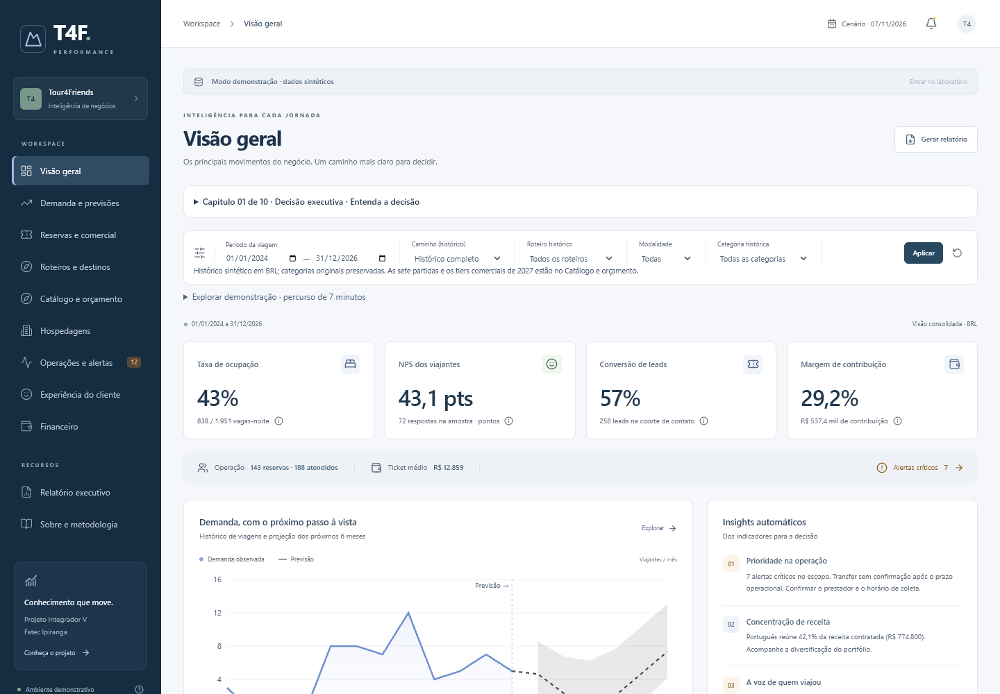
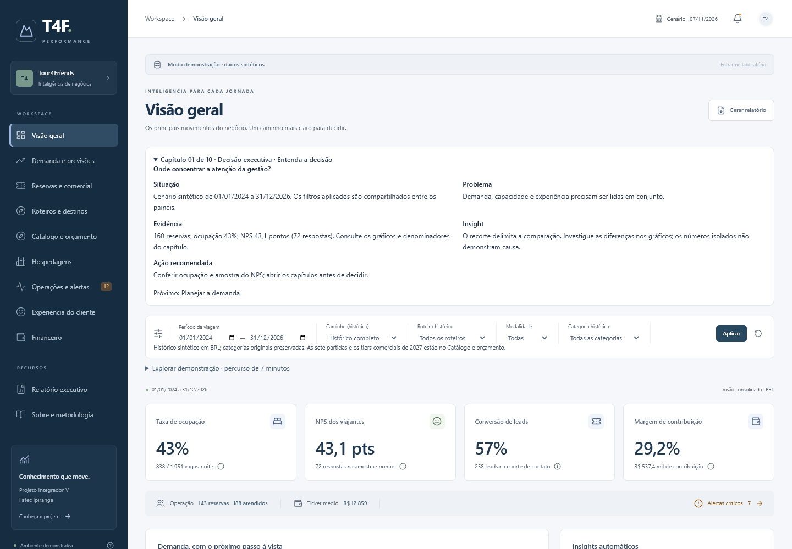
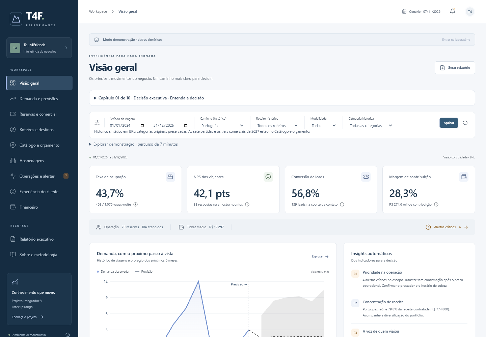
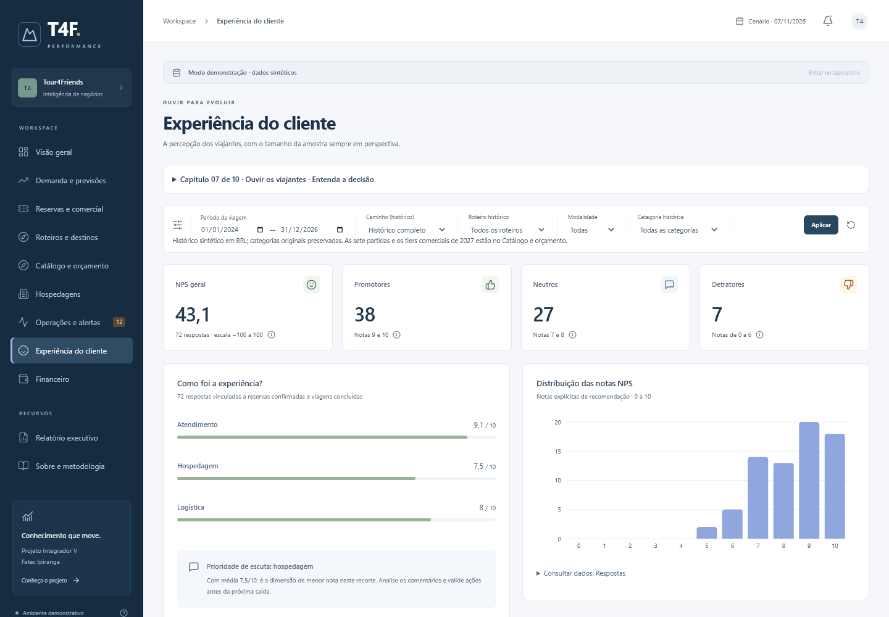
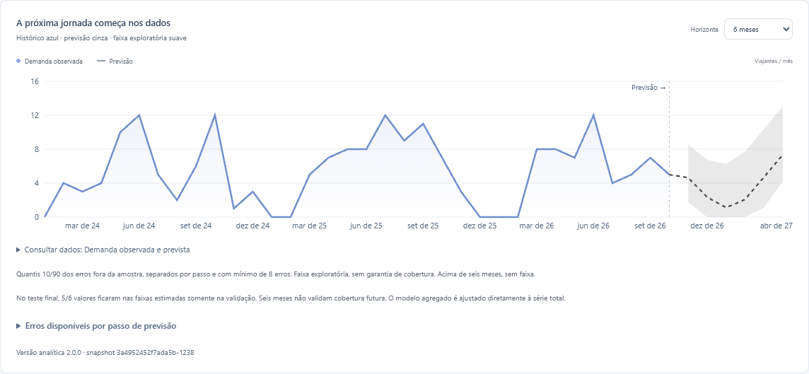
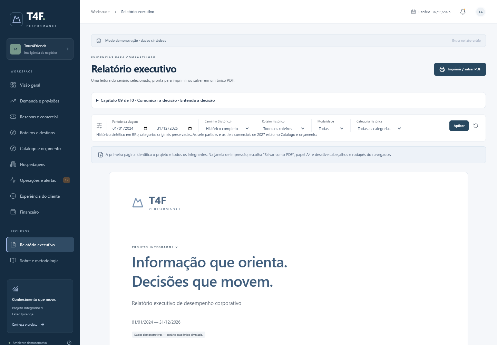

# Manual do usuário

## Abrir e identificar a versão

Site público: <https://thiago-code-lab.github.io/Dashboards-Tour4Friends/>. Alterações desta entrega só estarão publicadas após aprovação, integração e deployment. Para revisar a P2, use a branch `feature/p2-visualizacao-2026`, Node/npm e execute `npm ci`, `npm run build:demo`, `npm run preview`. Abra `http://127.0.0.1:4173/Dashboards-Tour4Friends/`. No PowerShell, use `npm.cmd` se necessário. A demonstração não precisa de Python, API ou banco.

Leia a faixa de fonte: “Modo demonstração” significa dados sintéticos estáticos. Cenário com referência 07/11/2026 não significa atualização até a data de hoje. Fotografias e percursos do catálogo são referências documentais.

## Navegar pelos dez capítulos

O menu apresenta Visão geral, Demanda e previsões, Reservas e comercial, Roteiros e destinos, Hospedagens, Operações e alertas, Experiência do cliente, Financeiro, Relatório executivo e Sobre e metodologia. “Catálogo e orçamento” é complementar. No celular, “Abrir menu” mostra a navegação; Escape fecha e devolve o foco.

Abra “Capítulo … Entenda a decisão” para ler Situação, Problema, Evidência, Insight e Ação recomendada. Use Anterior/Próximo para percorrer a narrativa. Esses links preservam filtros.

## Aplicar e limpar filtros

Preencha Data inicial/final; escolha Caminho (histórico), Roteiro histórico, Modalidade e Categoria histórica; clique **Aplicar**. Só então o recorte é recalculado. Caminho restringe opções; mudar modalidade pode limpar roteiro incompatível. “Limpar filtros” retorna ao período padrão 01/01/2024 a 31/12/2026 e todas as dimensões. Período inválido exibe erro; recorte sem registros exibe estado vazio. Filtros ficam nas preferências do navegador.

## Interpretar ocupação e NPS

Ocupação = comprometido / capacidade dos slots comparáveis, em porcentagem; o card informa vagas-noite. Confira Hospedagens por data/etapa/categoria antes de concluir que há vagas. Uma taxa global baixa pode coexistir com insuficiência em saídas específicas.

NPS = percentual de promotores menos detratores, em **pontos** de −100 a 100. Observe n e a distribuição; 43 pontos não significa 43% de satisfação. Em Experiência, compare atendimento/hospedagem/logística em 0-10. Traço indica ausência, não desempenho zero.

## Financeiro, previsões e decisões

Em Financeiro, confronte receita contratada, realizada gerencial, pagamentos, custos estimados/realizados e contribuição. Contribuição não é lucro líquido. O filtro de categoria rateia custos de saída pela receita; veja notas e metodologia.

Em Demanda, diferencie linha observada e projeção. Consulte modelo, amostra, MAE/RMSE/viés/WAPE e avaliação final. A faixa é exploratória; cenários não são garantias. O cenário de captura de 0,5% exige entrada/origem manual e não comprova market share conquistado.

## Exportar e gerar relatórios

Nas tabelas com **Exportar CSV**, busca, ordenação e filtros definem as linhas exportadas (todas as linhas do resultado, não só a página visível). Em Reservas, o modelo técnico de importação é diferente do CSV analítico. Dados importados são validados em lote; erro preserva a base anterior.

Em Relatório executivo, ajuste filtros e clique **Imprimir / salvar PDF**; selecione Salvar como PDF, A4, sem cabeçalhos/rodapés do navegador. O PDF executivo do recorte é diferente do relatório acadêmico P2, gerado em `output/pdf/P2_Visualizacao_de_Dados_T4F_Performance.pdf`.

## Atualizar e limites da demonstração

Na demonstração, atualizar a página ou **Recarregar base original** em Reservas lê o JSON versionado novamente. A requisição usa `cache: no-store`. Não busca novas vendas reais. Importações locais desaparecem ao restaurar/recarregar; não gravam PostgreSQL. Uma nova versão do JSON só chega ao site após deployment autorizado. Erros de leitura aparecem na tela com opção de tentar novamente.

No laboratório, atualização manual da API, foco da janela, intervalo de 30 segundos (janela visível e sem gravação em curso) e gravações bem-sucedidas atualizam o snapshot. Permissões dependem do perfil. Falha da API não troca silenciosamente para demonstração.

## Executar o laboratório relacional

Siga [backend/README](../../backend/README.md) e [operação](../operacao-laboratorio.md): configurar PostgreSQL e variáveis locais, instalar `backend/requirements.txt`, aplicar Alembic, executar seed e criar administrador pelo CLI seguro. Inicie FastAPI localmente e Vite com `VITE_API_BASE_URL=http://127.0.0.1:8000`; entre pelo botão **Entrar no laboratório**. Não publique credenciais no frontend. Docker Compose é alternativa documentada. O Pages continua independente.

Para **comprovar** integração em banco novo descartável, use Python com as dependências do backend e execute `python scripts/verify-p2-lab.py --pg-bin "C:/Program Files/PostgreSQL/18/bin"`. O runner cria cluster novo em pasta temporária e banco `t4f_p2_test` na porta local 55439, executa migração, Pytest e navegador conectado e encerra o cluster. Não usa o `.env` existente para escolher banco. Consulte [evidência relacional](integracao-relacional.md). Não execute as suítes destrutivas diretamente contra banco operacional.
