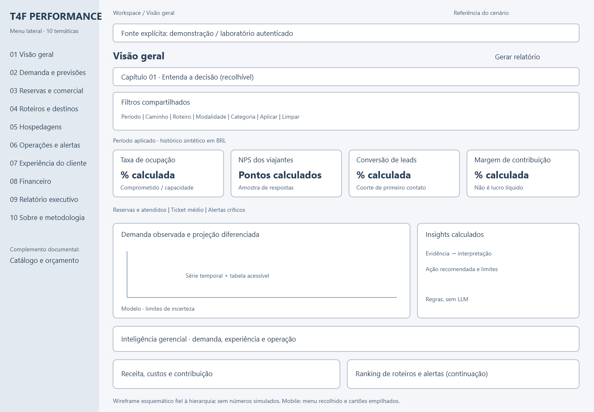
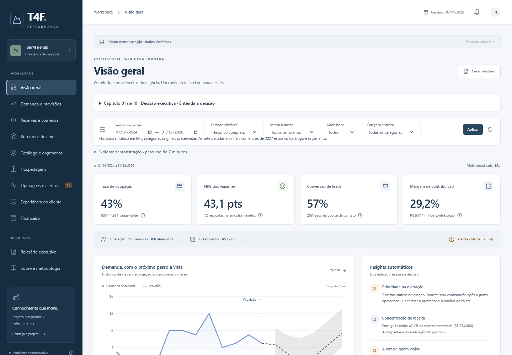
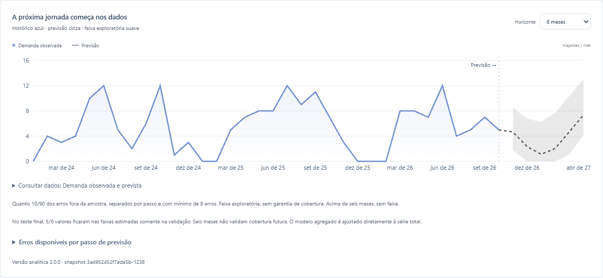
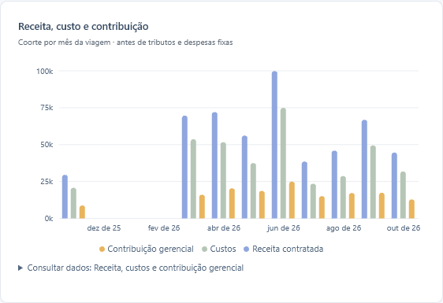
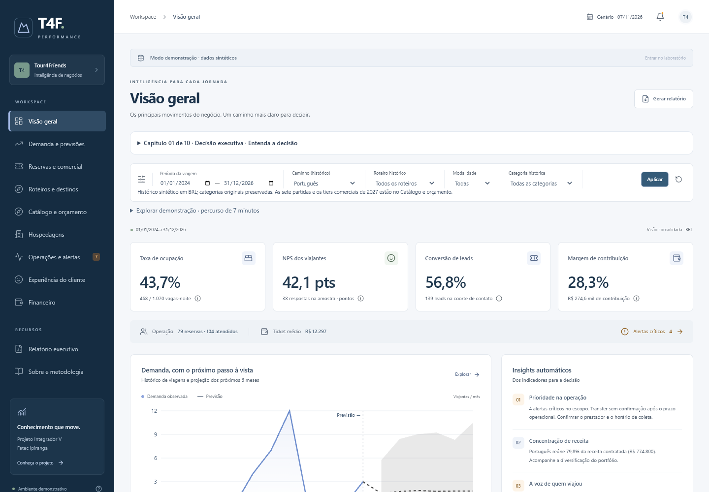

# Técnicas de visualização

## Estrutura e evidências

O wireframe é uma representação esquemática criada por código a partir da organização real: menu lateral, fonte dos dados, título/capítulo, filtros, quatro KPIs, série temporal, insights, financeiro e ranking. Não é uma captura. Campos sem valores representam posições, sem resultados fictícios.

Capturas reais geradas por `node scripts/capture-p2.mjs` sobre build local de produção. Não representam o site publicado nem aprovação do parceiro. O [manifesto](evidencias/capturas.json) informa URL, viewport e origem de cada imagem.

## Codificação visual

Linhas preservam a ordem dos meses e mostram evolução, picos e lacunas. Meses completos sem movimento permanecem zero; NPS ausente não deve ser interpretado como zero. Demanda observada e previsão têm séries/legendas próprias, projeções tracejadas e faixa exploratória sem garantia de cobertura. A seleção do modelo usa validação expansiva anterior aos seis meses finais; o teste não deve ser usado para escolher retrospectivamente o vencedor.

Barras compartilham uma escala para comparar comprimentos, apropriadas a roteiros, canais e dimensões. Rankings ordenados facilitam comparação, mas exigem olhar a amostra. Comparações de NPS entre grupos pequenos não provam diferença robusta. Evita-se reproduzir o mesmo ranking em gráficos decorativos.

Ocupação compara comprometido e capacidade dos mesmos slots de data/etapa/categoria. Cards mostram porcentagem e denominador em vagas-noite. Agregar pode esconder gargalos: a tabela de insuficiências preserva valores acima de 100% e vagas não são transferidas entre datas. A barra visual pode saturar em 100%, mas números/tabela mantêm o excesso.

NPS é apresentado em pontos, com amostra e distribuição das notas 0-10. Promotores são 9-10, neutros 7-8 e detratores 0-6. Satisfação tem dimensões separadas (atendimento, hospedagem, logística) em escala 0-10. Não se mistura média das notas com NPS.

Receita, custo e contribuição aparecem em BRL e com legenda. Contribuição negativa permanece visível; contribuição = receita contratada − custos incluídos. Custos realizados/estimados, rateio de categoria e compromissos futuros limitam o resultado. Não há cálculo completo de lucro líquido.

O gráfico financeiro mostra os 12 meses finais da série histórica filtrada. Cards e tabelas consolidadas usam todo o recorte aplicado e podem incluir compromissos futuros; por isso não se deve comparar a soma das barras visíveis diretamente ao card sem igualar o período.

Alertas operacionais decorrem de limites/regras configurados. Anomalias estatísticas exigem método, referência e amostra mínima; não são sinônimos. A ausência de anomalia detectada não prova ausência de risco.

## Cores, tipografia e acesso

Azul organiza informação e sage/verde destaca experiência; laranja sinaliza atenção. Textos de estado, ícones, rótulos e tabelas complementam a cor. O mapa documental preserva disponibilidade desconhecida quando não há fonte verificável. Títulos, valores e notas têm hierarquia própria; seções recolhíveis reduzem densidade sem esconder KPIs. Os dez capítulos têm pergunta e próxima ação.

Labels nos filtros, foco visível, atalho para conteúdo, menu móvel com controle de foco, tabelas alternativas e exportação permitem acesso além do hover nos gráficos. Testes axe-core são evidência automatizada restrita; não comprovam conformidade WCAG completa. Conferência visual desktop/celular e resultados efetivamente executados constam no [checklist](checklist-entrega.md).

